<p align="center">
  <picture>
  <source media="(prefers-color-scheme: light)" srcset=".github/assets/banner-light.svg">
  
</picture>
</p>

<p align="center">
  <i>Every week CERT-FR publishes bulletins that cite hundreds of CVEs. Which ones actually matter?</i><br>
  CVE Watch reads them, enriches every CVE (MITRE, NVD, FIRST EPSS, CISA KEV), ranks them<br>
  and emails the people whose product and version are affected.
</p>

<p align="center"><sub>School project done in December 2024 / January 2025 with a fellow student from the school (<a href="https://github.com/rompiiish">@rompiiish</a>), then reworked and restructured.</sub></p>

<p align="center">
<picture>
  <source media="(prefers-color-scheme: light)" srcset=".github/assets/divider-light.svg">
  
</picture>
</p>

<p align="center">
<picture>
  <source media="(prefers-color-scheme: light)" srcset=".github/assets/stats-light.svg">
  
</picture>
</p>

<h3>
<picture>
  <source media="(prefers-color-scheme: light)" srcset=".github/assets/h-how-it-works-light.svg">
  
</picture>
</h3>

<p align="center">
<picture>
  <source media="(prefers-color-scheme: light)" srcset=".github/assets/pipeline-light.svg">
  
</picture>
</p>

1. The CERT-FR `avis` (advisory) and `alerte` (alert) feeds are read with `feedparser`. Only bulletins newer than the last one already in the CSV are kept.
2. Each bulletin also exists as JSON (`<link>/json/`), which lists the CVEs it covers.
3. Each CVE is enriched from the MITRE API: CVSS and severity, CWE, and **every** affected product with its version ranges (a single CVE often affects several products, for example FortiOS and FortiProxy). When the CNA leaves fields empty, the CISA ADP block fills in. If there is still no CVSS, which is the case for nearly every Linux kernel CVE (kernel.org does not publish scores), it comes from NVD.
4. EPSS changes every day, so it is refreshed on every run for CVEs from the last 30 days, in batches of 100.
5. Each CVE gets a priority level, with the KEV catalog downloaded on every run.
6. For level 1 and 2 CVEs, every subscriber watching an affected product gets one mail per CVE, logged in `data/email_log.csv`.

<h3>
<picture>
  <source media="(prefers-color-scheme: light)" srcset=".github/assets/h-priorities-light.svg">
  
</picture>
</h3>

| Level | Condition | Why |
|-------|-----------|-----|
| **1 - Exploited** | in the CISA KEV catalog, or cited in a CERT-FR alert | confirmed exploitation. CERT-FR publishes an "Alerte", not just an "Avis", when a flaw is being exploited |
| **2 - Watch** | EPSS >= 0.1 or CVSS >= 9 | high probability of exploitation in the next 30 days, or critical severity |
| **3 - Other** | everything else | |

Within a level, CVEs are sorted by presence in KEV, then EPSS, then CVSS.

<h3>
<picture>
  <source media="(prefers-color-scheme: light)" srcset=".github/assets/h-does-the-ranking-hold-up-light.svg">
  
</picture>
</h3>

The first version only alerted on CVSS >= 9. To check whether that was a good idea, every rule was compared with the KEV catalog, used as ground truth (`python -m cvewatch --evaluate`). KEV itself is left out of the rules under test, otherwise it would find itself.

Only 50 of the 1,842 CVEs are in KEV. The catalog only lists flaws for which CISA has evidence of exploitation in the wild (1,756 entries when the evaluation was run), so it covers a small share of published CVEs. The dataset is also dominated by Linux kernel CVEs, and few of them appear in KEV: 2 of the 1,255 kernel CVEs, against 48 of the 587 others. A CVE missing from KEV is not proof that it was never exploited, only that CISA has not listed it.

<p align="center">
  <picture>
  <source media="(prefers-color-scheme: light)" srcset=".github/assets/kev_recall-light.svg">
  = 9 alone 58 %, CVSS or EPSS 80 %, CERT-FR alert 86 %, CVSS, EPSS or CERT-FR alert 92 %">
</picture>
</p>

| Rule | Flagged CVEs | KEV CVEs found | Recall | Precision |
|------|--------------|----------------|--------|-----------|
| CVSS >= 9 (first version) | 84 | 29 / 50 | 58 % | 35 % |
| CVSS >= 9 or EPSS >= 0.1 | 99 | 40 / 50 | 80 % | 40 % |
| CERT-FR alert | 73 | 43 / 50 | 86 % | 59 % |
| **CVSS, EPSS or CERT-FR alert** | **122** | **46 / 50** | **92 %** | **38 %** |

What this shows:

- **CVSS alone misses heavily exploited flaws.** CVE-2024-9474 on PAN-OS has a CVSS of 6.9 but an EPSS of 0.97, and several Ivanti and Cisco flaws scored between 6 and 8 were exploited too.
- **The best signal was already in the data, unused:** the CERT-FR bulletin type.
- **EPSS and CVSS add the exploited CVEs** that CERT-FR did not publish as an alert.

<details>
<summary><b>A note on hindsight</b></summary>

The KEV catalog used is much more recent than the collection. Of the 44 CVEs that were already in KEV when the collection ended (8 January 2025), the signals find 43. Of the 6 added to KEV later, 3 were already flagged at collection time (two by a CERT-FR alert, one by its CVSS). The EPSS scores used in the evaluation are those from collection time.

</details>

<p align="center">
<picture>
  <source media="(prefers-color-scheme: light)" srcset=".github/assets/divider-light.svg">
  
</picture>
</p>

<h3>
<picture>
  <source media="(prefers-color-scheme: light)" srcset=".github/assets/h-quick-start-light.svg">
  
</picture>
</h3>

```bash
git clone https://github.com/kr-Eliza/PythonCVE.git
cd PythonCVE
python -m venv .venv
source .venv/bin/activate        # .venv\Scripts\activate on Windows
pip install -r requirements.txt
```

<details>
<summary><b>Configuration</b>: <code>.env</code> variables and subscriptions</summary>

Credentials are not in the code, they are read from a `.env` file:

```bash
cp .env.example .env
```

| Variable | Role |
|----------|------|
| `SMTP_HOST`, `SMTP_PORT` | mail server (Gmail by default) |
| `SMTP_USER`, `SMTP_PASSWORD` | sending account. With Gmail you need an [app password](https://myaccount.google.com/apppasswords) |
| `CVSS_ALERT_THRESHOLD` | CVSS from which a CVE moves to level 2 (9.0) |
| `EPSS_ALERT_THRESHOLD` | EPSS from which a CVE moves to level 2, whatever its CVSS (0.1) |
| `ALERT_WINDOW_DAYS` | CVEs from bulletins newer than this many days are re-assessed on every run (30) |
| `NVD_API_KEY` | optional. Without a key NVD allows 5 requests per 30 s, 50 with a [free key](https://nvd.nist.gov/developers/request-an-api-key) |
| `MAX_ENTRIES_PER_FEED` | number of entries read from each feed (5) |

Without `SMTP_USER` and `SMTP_PASSWORD`, collection still works and alerts are only written to the logs.

Subscribers are listed in `subscriptions.json` (not versioned):

```bash
cp subscriptions.example.json subscriptions.json
```

```json
{
  "soc@example.com": [
    {"product": "FortiOS", "version": "7.2.4"},
    "FortiProxy"
  ]
}
```

A watched product is either a name, or a name with the installed version. With a version, the alert is only sent if that version falls in the affected ranges of the MITRE record. If the record does not allow a decision, the alert is still sent with the note "version could not be checked". Names must match the `product` field of MITRE records (`FortiOS`, `OpenSSL`, `Apache Tomcat`...), case-insensitively.

</details>

<h3>
<picture>
  <source media="(prefers-color-scheme: light)" srcset=".github/assets/h-usage-light.svg">
  
</picture>
</h3>

Dashboard:

```bash
streamlit run app.py
```

| Page | Content |
|------|---------|
| Home | number of CVEs per level and a button to run a collection |
| What to fix first | one row per CVE, sorted by level, with the reason (KEV, CERT-FR alert, EPSS, CVSS), filters by level, vendor and product |
| CVE | 10 latest CVEs and the details of one CVE with its priority |
| Mails | history of the alerts sent, per recipient |
| Charts | CVEs per level, top CWEs, EPSS distribution, CVSS vs EPSS, new CVEs per month, most affected products, trend by severity |
| Filter by date | CVEs published on a given day |

Charts count each CVE once, even when several bulletins cite it. A checkbox in the sidebar hides Linux kernel CVEs: a single kernel bulletin sometimes cites hundreds of CVEs, which make up 68 % of the CVEs in the dataset and flatten everything else.

Command line:

```bash
python -m cvewatch                 # one collection
python -m cvewatch --no-mail       # without sending mails
python -m cvewatch --loop 30       # every 30 minutes
python -m cvewatch --backfill      # complete existing data: CVSS (NVD) and affected products (MITRE)
python -m cvewatch --refresh-epss  # update the EPSS of every CVE
python -m cvewatch --evaluate      # compare the priority rules with the KEV catalog
```

`--backfill` saves regularly and can be run again if interrupted. It does not ask again for CVEs already handled, except those for which the API did not answer.

Tests:

```bash
pip install -r requirements-dev.txt
pytest
```

The notebook `notebooks/exploration.ipynb` holds the first exploratory analysis of the dataset (matplotlib / seaborn).

<details>
<summary><b>Layout</b></summary>

```
app.py                  Streamlit dashboard
cvewatch/
    config.py           .env loading and constants
    feeds.py            CERT-FR feeds and CVE extraction
    enrich.py           MITRE, NVD and EPSS calls
    versions.py         affected products and version comparison
    kev.py              CISA KEV catalog (with a local cache)
    priority.py         one row per CVE and priority level
    alerts.py           subscriptions, sending and mail log
    evaluate.py         priority rules compared with KEV
    pipeline.py         collection, backfill and command line
    data.py             data loading for the dashboard
data/cve_data.csv       collected data (Dec. 2024 - Jan. 2025)
notebooks/              exploratory analysis
tests/                  pytest tests
```

</details>

<details>
<summary><b>Data</b>: columns and CVSS coverage</summary>

One row per (bulletin, CVE) pair, `;` separator.

| Column | Source |
|--------|--------|
| `Title`, `Description`, `Link`, `Date`, `Type` | CERT-FR feed (`Type` = `Avis` for an advisory, `Alerte` for an alert). Bulletin titles are in French |
| `CVE` | bulletin JSON |
| `CVSS`, `Base Severity` | MITRE API, otherwise NVD |
| `CVSS_Source` | `MITRE`, `NVD`, or `none` if NVD has not analyzed the CVE yet |
| `CWE`, `CVE_Description` | MITRE API |
| `Vendor`, `Product`, `Versions` | first affected product of the MITRE record, versions as readable text |
| `Affected` | every affected product with its version ranges (JSON), used for alerts |
| `EPSS` | FIRST EPSS API |
| `CWE_ID` | CWE identifier alone, taken from `CWE` |

The priority level is not stored: it depends on the current KEV catalog and is computed when displaying and on every run.

In the first version only the MITRE CVSS was used and 75 % of the rows had no score, nearly all of them Linux kernel CVEs. With the NVD fallback and the affected products re-read from MITRE (`--backfill` on existing data):

| | Before | After |
|---|---|---|
| Rows with a CVSS | 568 / 2,294 (25 %) | 2,259 / 2,294 (98 %) |
| Rows shown in the dashboard | 533 | 2,113 |

Of the 1,842 distinct CVEs, 440 have their score in the MITRE record, 1,376 in NVD, and 26 had not been scored by NVD yet at backfill time.

</details>

<h3>
<picture>
  <source media="(prefers-color-scheme: light)" srcset=".github/assets/h-limits-light.svg">
  
</picture>
</h3>

- CERT-FR feeds only hold the latest bulletins, so collections spaced too far apart can miss some.
- Linux kernel bulletins often cite several hundred CVEs, so the first collection can take a few minutes.
- Watched product names must match those of MITRE records, which are not always consistent across vendors (`FortiOS` on the CNA side, `fortios` on the CISA side).
- Version comparison follows the ranges declared in the record. For the Linux kernel, those ranges describe stable branches where the fix was backported, and a distribution kernel (Debian, RHEL) can be fixed without changing its version number: the result is only indicative.
- The evaluation relies on 50 KEV CVEs, so it gives an order of magnitude rather than a precise measure.
